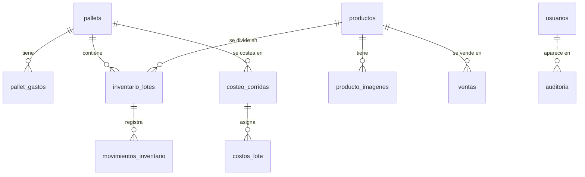

# Fase 1 — Pallets, inventario por lotes y costeo

**Entregable:** costo real por producto.
**Fecha de cierre:** 18 de noviembre de 2026.
**Estado:** concluida. 23 pruebas automatizadas en verde; regresión de las funciones existentes sin errores. Ver la sección 9.

Decisiones aplicadas (sección 11 del diagnóstico): inventario **por lotes**, **inicio de sesión local**, régimen fiscal **pendiente** (no aplica en esta fase) y condición **nuevo → Nuevo sellado**.

---

## 1. Alcance

| Incluido | Fuera de esta fase |
|---|---|
| Registro de pallets (moneda, tipo de cambio, costo convertido, estatus) | Plataformas, tarifas y motor de precios por canal (Fase 2) |
| Gastos adicionales del pallet (incluidos o no en el costo) | Ventas con comisiones, cobros, devoluciones, costo histórico por venta (Fase 3) |
| Inventario por lotes (juguete × pallet × condición) con kárdex | Movimientos de inventario generados por ventas (Fase 3) |
| Costeo equitativo, proporcional y manual, con historial y cuadre al centavo | Recuperación de inversión por pallet (prueba 20 → Fase 3) |
| Datos comerciales del producto (marca, modelo, medidas, edad, estado comercial…) | Competencia, dashboard y reportes (Fase 4) |
| Inicio de sesión, usuarios y bitácora de auditoría | Integraciones con APIs de marketplaces (Fase 5) |
| Migración no destructiva de la versión anterior a "Pallet 1" | |

---

## 2. Requerimientos funcionales

| ID | Requerimiento |
|---|---|
| RF-1.1 | Registrar un pallet con nombre, proveedor, fecha de compra, país de origen, moneda (MXN/USD), costo de compra, tipo de cambio aplicado y su fuente (DOF o manual), estatus, método de costeo y tratamiento de piezas no vendibles. |
| RF-1.2 | Calcular el costo en MXN (costo × tipo de cambio, redondeado al centavo) y la inversión total (costo MXN + gastos no incluidos). |
| RF-1.3 | Registrar gastos del pallet indicando si ya están incluidos en el costo de compra (se registran pero no se suman). |
| RF-1.4 | Cada juguete pertenece a uno o más lotes; un lote es juguete × pallet × condición con su cantidad. |
| RF-1.5 | Condiciones: Nuevo sellado, Nuevo con caja abierta, Usado en buenas condiciones, Usado con detalles, Incompleto, Dañado, No comercializable. Las tres últimas son no vendibles por omisión; Incompleto y Dañado pueden marcarse como vendibles (liquidación). |
| RF-1.6 | Movimientos de inventario (kárdex) por alta, recepción, ajuste y cambio de condición, con usuario, fecha y motivo. |
| RF-1.7 | Costeo con tres métodos: equitativo, proporcional al valor comercial relativo (predeterminado) y manual. |
| RF-1.8 | Simular el costeo sin guardar; aplicarlo guarda una corrida vigente y conserva las anteriores como historial inmutable. |
| RF-1.9 | Detectar cuando el costeo vigente quedó desactualizado (cambió la inversión, las piezas, la condición o el valor relativo). |
| RF-1.10 | Mostrar el costo real por pieza en el inventario, en la ficha del juguete y en el pallet. |
| RF-1.11 | Datos comerciales del juguete: SKU (código), código de barras, marca, modelo, categoría, subcategoría, descripción comercial, accesorios, edad recomendada, peso, largo, ancho, alto, fecha de ingreso, estado comercial, observaciones y fotos. |
| RF-1.12 | Inicio de sesión con usuario y contraseña; alta de usuarios; cambio de contraseña; cierre de sesión. |
| RF-1.13 | Bitácora de altas, cambios y bajas con usuario, fecha y valores antes/después. |

## 3. Requerimientos no funcionales

| ID | Requerimiento | Cómo se cumple |
|---|---|---|
| RNF-1 | Exactitud monetaria | `decimal` en C#; redondeo comercial al centavo; reparto por residuo mayor; prueba con 1,000 escenarios aleatorios × 4 combinaciones |
| RNF-2 | Reproducibilidad | El desempate del residuo mayor es por identificador del lote: misma entrada → mismo resultado |
| RNF-3 | No destructivo | Migración idempotente, respaldo `pallet-antes-de-fase1-*.db` antes de migrar; no se borra ninguna columna ni dato |
| RNF-4 | Seguridad | Toda la API y las fotos requieren sesión; PBKDF2-SHA256 de 600,000 iteraciones; cookie HttpOnly + SameSite=Strict; bloqueo de 5 minutos tras 5 intentos fallidos; cambiar la contraseña invalida las demás sesiones |
| RNF-5 | Integridad | Llaves foráneas con `RESTRICT`; índice único (producto, pallet, condición); `CHECK Cantidad >= 0`; cada operación se guarda en una sola transacción |
| RNF-6 | Concurrencia | Las escrituras de inventario y costeo pasan por el candado global existente |
| RNF-7 | Compatibilidad | Las pantallas anteriores siguen operando; los clientes que aún envían "estado" se traducen a condición |
| RNF-8 | Responsivo | Probado a 390 px de ancho, sin desplazamiento horizontal |

## 4. Reglas de negocio

| ID | Regla |
|---|---|
| RN-1 | **Inversión total** = costo de compra en MXN + Σ gastos del pallet **no** incluidos en el costo. El costo de importación ya viene en el costo de compra. |
| RN-2 | **Costo en MXN** = costo de compra × tipo de cambio, redondeado al centavo. En MXN el tipo de cambio es 1. En USD es obligatorio y mayor a cero. |
| RN-3 | **Valor relativo** de un lote = el capturado en el lote; si no hay, el precio en México del juguete. |
| RN-4 | **Proporcional:** peso = piezas × valor relativo; costo del lote = inversión × peso ÷ Σ pesos. Si algún lote participante no tiene valor relativo, el costeo se rechaza indicando cuál. |
| RN-5 | **Equitativo:** peso = piezas. |
| RN-6 | **Manual:** se captura el costo total de cada lote; la suma debe ser exactamente la inversión, o se rechaza indicando la diferencia. |
| RN-7 | **Piezas no vendibles — Absorber** (predeterminado, decisión 11.5): reciben costo 0; la inversión se reparte entre las vendibles. Se informa aparte cuánto habrían cargado (costo absorbido). |
| RN-8 | **Piezas no vendibles — Pérdida:** reciben su parte y esa parte se reconoce como merma. |
| RN-9 | **Cuadre:** Σ costo asignado a vendibles + Σ merma = inversión total, exacto al centavo. Se reparte en centavos con el método del residuo mayor; si no cuadrara, el resultado se rechaza. |
| RN-10 | **Costo por pieza** = costo del lote ÷ piezas, a 4 decimales (informativo). El monto que cuadra es el costo del lote. |
| RN-11 | Los productos no vendibles **no se eliminan**: quedan en su lote, con tratamiento merma, liquidación o recuperación parcial. |
| RN-12 | Aplicar un costeo crea una corrida nueva vigente; las anteriores se conservan sin cambios. |
| RN-13 | La cantidad total de un juguete no puede quedar por debajo de lo vendido o apartado. |
| RN-14 | Con un solo lote, la cantidad y la condición se editan desde la ficha del juguete (se registra un ajuste). Con varios lotes, se editan en cada lote. |
| RN-15 | La inversión global (Ajustes y Resumen) es la suma de las inversiones de los pallets. |
| RN-16 | **Precio mínimo** (botón "Recalcular precios mínimos"): el costo real por pieza redondeado hacia arriba al peso; sin costeo, la estimación proporcional anterior. El cálculo con comisiones y márgenes llega en la Fase 2. |

## 5. Modelo de datos (entidades nuevas y ampliadas)

### Diccionario de datos

Montos: `decimal` (TEXT exacto en SQLite). Identificadores: TEXT de 12 caracteres hexadecimales, salvo los autoincrementales indicados.

**pallets**
| Campo | Tipo | Regla |
|---|---|---|
| Id | TEXT PK | |
| Nombre | TEXT(80) | Obligatorio, único |
| Proveedor, PaisOrigen | TEXT | |
| FechaCompra | DATE | |
| Moneda | TEXT(3) | MXN o USD |
| CostoOriginal | decimal | ≥ 0, en la moneda de compra |
| TipoCambio | decimal(4) | 1 en MXN; > 0 en USD |
| TipoCambioFuente | TEXT | DOF, Manual o vacío |
| CostoMxn | decimal(2) | RN-2 (calculado) |
| GastosAdicionales | decimal(2) | Σ gastos no incluidos (calculado) |
| InversionTotal | decimal(2) | RN-1 (calculado) |
| Estatus | TEXT | recepcion, en_venta, liquidado, cerrado |
| MetodoCosteo | TEXT | equitativa, proporcional, manual |
| ModoMerma | TEXT | absorber, perdida |
| Notas, CreadoUtc, ActualizadoUtc | | |

**pallet_gastos**: Id, PalletId (FK restrict), Fecha, Tipo, Concepto, MontoMxn (≥ 0), IncluidoEnCosto (bool), CreadoUtc.

**inventario_lotes**
| Campo | Tipo | Regla |
|---|---|---|
| Id | TEXT PK | |
| ProductoId | FK productos (restrict) | |
| PalletId | FK pallets (restrict) | |
| Condicion | TEXT | Una de las 7 condiciones; único (ProductoId, PalletId, Condicion) |
| Comercializable | bool | Por omisión según la condición; "No comercializable" siempre falso |
| Tratamiento | TEXT | merma, liquidacion, recuperacion_parcial o vacío |
| Cantidad | INT | ≥ 0 (CHECK); igual a Σ de sus movimientos |
| ValorRelativoUnitario | decimal? | Null = precio en México del juguete |
| FechaIngreso, Notas, CreadoUtc, ActualizadoUtc | | |

**movimientos_inventario**: Id (autoincremental), LoteId (FK restrict), FechaUtc, Tipo (inventario_inicial, recepcion, ajuste, reclasificacion_salida, reclasificacion_entrada), Cantidad (con signo), Referencia, Motivo, Usuario. Solo se agregan; no se modifican.

**costeo_corridas**: Id, PalletId (FK), FechaUtc, Usuario, Metodo, ModoMerma, TotalDistribuible, TotalComercializable, TotalMerma, CostoAbsorbidoPorMerma, CentavosAjustados, Vigente (una por pallet), Huella (SHA-256 de inversión y lotes, para detectar desactualización), Notas.

**costos_lote**: Id (autoincremental), CorridaId (FK), LoteId, ProductoId, Condicion, Comercializable, Cantidad, ValorRelativoUnitario, Peso, CostoTotal, CostoUnitario, EsMerma. Es una copia inmutable de cada lote al momento del costeo.

**usuarios**: Id, Nombre (único, sin distinguir mayúsculas), NombreCompleto, Hash, Sal, Iteraciones, Activo, CreadoUtc, UltimoAccesoUtc.

**auditoria**: Id (autoincremental), FechaUtc, Usuario, Entidad (tabla), EntidadId, Accion (alta/cambio/baja), Cambios (JSON `{campo: [antes, después]}`; nunca incluye el hash ni la sal de la contraseña).

**productos (columnas nuevas)**: Marca, Modelo, Subcategoria, DescripcionComercial, AccesoriosIncluidos, EdadRecomendada, PesoKg, LargoCm, AnchoCm, AltoCm, EstadoComercial (en_revision, listo, liquidacion, retirado), FechaIngreso. `Cantidad` y `Estado` se conservan y se derivan de los lotes. `Codigo` es el SKU.

---

## 6. Diseño técnico

| Componente | Archivo | Responsabilidad |
|---|---|---|
| Núcleo de costeo (puro, sin base de datos) | `Dominio/Calculo/Costeo.cs` | Conversión, inversión, distribución con cuadre al centavo |
| Reglas de inventario y costeo | `Servicios/Inventario.cs` | Movimientos, lotes, reclasificación, huella, sincronizaciones |
| Contraseñas | `Servicios/Contrasenas.cs` | PBKDF2, verificación en tiempo constante, sello de sesión |
| Unidades | `Servicios/Unidades.cs` | Libras/onzas → kg; pulgadas → cm (datos de UPCitemdb) |
| API de acceso | `Endpoints/AuthApi.cs` | Configuración inicial, entrar, salir, contraseña, usuarios |
| API de pallets, lotes y costeo | `Endpoints/PalletsApi.cs` | Endpoints de la sección 6.1 |
| Auditoría | `Data/AppDbContext.cs` | Se registra al guardar (`SaveChanges`) |
| Esquema | `Data/Esquema.cs` | Crea las tablas faltantes con el script de EF Core y migra a "Pallet 1" |
| Interfaz | `wwwroot/js/analisis.js` | Pantalla Pallets y costos y acciones sobre lotes |
| Interfaz (existente, ampliada) | `wwwroot/js/app.js` | Acceso, ficha, inventario, importación |

### 6.1 API nueva (todas requieren sesión, salvo `/api/auth/*`)

| Método | Ruta | Uso |
|---|---|---|
| GET | `/api/auth/estado` | ¿Hay sesión? ¿Falta crear el primer usuario? |
| POST | `/api/auth/configurar` | Primer usuario (solo desde la misma computadora) |
| POST | `/api/auth/entrar` · `/api/auth/salir` | Iniciar y cerrar sesión |
| POST | `/api/auth/contrasena` | Cambiar contraseña |
| GET/POST | `/api/usuarios` · `/api/usuarios/{id}/activo` | Usuarios |
| GET/POST | `/api/pallets` | Lista con resumen / alta |
| GET/PUT/DELETE | `/api/pallets/{id}` | Detalle (gastos, lotes, costeo vigente, historial) / edición / baja (sin lotes ni costeos) |
| POST | `/api/pallets/{id}/gastos` | Gasto del pallet |
| PUT/DELETE | `/api/pallet-gastos/{id}` | Editar / borrar gasto |
| GET/POST | `/api/productos/{id}/lotes` | Lotes y kárdex del juguete / nuevo lote |
| PUT | `/api/lotes/{id}` | Vendible, tratamiento, valor relativo, notas |
| POST | `/api/lotes/{id}/ajuste` | Sumar o restar piezas (con motivo) |
| POST | `/api/lotes/{id}/reclasificar` | Mover piezas a otra condición |
| POST | `/api/pallets/{id}/costeo/simular` | Calcular sin guardar |
| POST | `/api/pallets/{id}/costeo/aplicar` | Guardar corrida vigente |
| GET | `/api/costeo/corridas/{id}` | Detalle de una corrida (vigente o histórica) |

Cambios en la API existente: `POST /api/productos` requiere `palletId` (si hay un solo pallet se usa ese) y acepta `condicion` y los datos comerciales; `POST /api/productos/importar?palletId=`; `GET /api/estado` incluye `pallets`, `lotes` y `costos`; `PUT /api/configuracion` ya no cambia la inversión cuando hay pallets.

### 6.2 Decisiones técnicas

| Decisión | Motivo |
|---|---|
| Montos `decimal` (TEXT en SQLite) y agregados en C# | Exactitud; SQLite no ordena ni suma `decimal` (comprobado en la Fase 0) |
| Residuo mayor al centavo, desempate por Id de lote | Cuadre exacto y resultado reproducible |
| Costo del lote como monto que cuadra; costo por pieza informativo a 4 decimales | Evita diferencias de centavos al multiplicar |
| Corridas inmutables + huella SHA-256 | Historial auditable y detección automática de costeos desactualizados |
| Tablas nuevas creadas desde el script de EF Core | Una base migrada queda idéntica a una nueva (verificado tabla por tabla) |
| Auditoría en `SaveChanges` | Cubre todas las rutas de escritura sin repetir código |
| Primer usuario solo desde la misma computadora (loopback) | Nadie en la red puede apropiarse de una instalación nueva |
| Interfaz nueva en `analisis.js` | No seguir creciendo `app.js`; comparte funciones mediante `window.PC` |

---

## 7. Historias de usuario y criterios de aceptación

**HU-1. Registrar un pallet en dólares.** Como dueño, quiero capturar un pallet comprado en USD con su tipo de cambio para conocer su inversión en pesos.
- Dado un pallet de US$2,500.00 con TC 18.7147, el costo en MXN es $46,786.75.
- Si agrego un gasto de $1,200.00 no incluido, la inversión es $47,986.75; uno marcado como incluido no la cambia.
- Sin tipo de cambio en USD, el sistema rechaza el registro.

**HU-2. Clasificar piezas por condición.** Como dueño, quiero separar las piezas dañadas sin borrarlas.
- Al mover 2 de 12 piezas a "Dañado", el juguete sigue con 12 piezas en dos lotes (10 + 2) y el kárdex registra salida y entrada.
- Las piezas dañadas quedan como no vendibles, con tratamiento seleccionable.

**HU-3. Conocer el costo real por pieza.** Como dueño, quiero repartir la inversión entre los juguetes.
- La simulación muestra el costo por lote y por pieza y el cuadre "Exacto al centavo".
- Al aplicar, el inventario y la ficha muestran el costo por pieza.
- Si después cambian piezas, gastos o valores, el costeo aparece como "Desactualizado".

**HU-4. Conservar el historial.** Como dueño, quiero que recalcular no borre costeos anteriores.
- Tras dos costeos, el historial muestra ambos; el anterior conserva sus montos originales.

**HU-5. Proteger la información.** Como dueño, quiero que nadie en mi red vea mis números sin contraseña.
- Sin sesión, la API y las fotos responden 401.
- Cinco intentos fallidos bloquean el usuario 5 minutos.

---

## 8. Casos de prueba (resultados esperados)

| # | Caso | Datos | Resultado esperado | Prueba |
|---|---|---|---|---|
| 1 | Pallet en USD | US$2,500.00 × 18.7147; gasto $1,200 no incluido; gasto $500 incluido | Costo MXN $46,786.75; inversión $47,986.75 | Unitaria + integración |
| 2 | Conversión USD→MXN | US$1,234.56 × 18.7147 = 23,104.420032 | $23,104.42 | Unitaria |
| 3 | Equitativa | $1,000.00 entre 3 + 4 piezas | $428.57 y $571.43 (1 centavo de residuo); $142.8567 y $142.8575 por pieza | Unitaria |
| 4 | Proporcional | $49,000 · 12×$1,099 · 30×$150 · 4×$1,274.50 | $28,360.05 · $9,676.99 · $10,962.96 (suma $49,000.00) | Unitaria + integración |
| 5 | Manual | $1,000 con $600 + $399.99 / $600 + $400 | Rechazo con diferencia $0.01 / aceptado | Unitaria + integración |
| 6 | Dañados | $1,200 · 10 vendibles + 2 dañadas, valor $100 | Absorber: $1,200 / $0, absorbido $200. Pérdida: $1,000 + $200 de merma | Unitaria + integración (reclasificación) |
| 7 | Cuadre total | $100 entre 3 piezas; 1,000 escenarios aleatorios | $33.34 / $33.33 / $33.33; Σ = total siempre, al centavo | Unitaria |
| 18 | Modificación de costos | Costeo, gasto +$400, nuevo costeo | Costeo 1 marcado desactualizado; costeo 2 de $1,400; costeo 1 conserva $1,000 | Integración |
| — | Seguridad | Sin sesión | 401 en API y fotos | Integración |
| — | Auditoría | Alta y cambio de pallet | Bitácora "alta" y "cambio" con usuario y CostoOriginal 777 → 800 | Integración |
| — | Inventario y ventas | 7 vendidas; ajuste que deja 6 | Rechazo 409 | Integración |

**Ejecución:** `dotnet test PalletControl.sln` → **23 de 23 en verde** (15 unitarias, 8 de integración).

### 8.1 Pruebas adicionales ejecutadas (navegador, fuera del repositorio)

- **Flujo completo de la Fase 1:** primer usuario → pallet USD → gasto → importación → simulación → aplicación → reclasificación → costeo con merma → historial → kárdex → juguete nuevo con datos comerciales → salir y volver a entrar → celular de 390 px. Sin errores en la consola.
- **Regresión:** inventario, ventas, gastos, semana y sincronización entre dos navegadores; precios por tienda, carrusel y traducción; código de barras; imágenes, tipo de cambio y valor del pallet. Todo coincide con los resultados de las versiones anteriores.
- **Migración:** base creada por la versión anterior (3 juguetes, 1 venta, 1 foto) → "Pallet 1" con la inversión de Ajustes, 3 lotes con su condición, venta, foto y cantidades intactas, respaldo previo creado. Estructura idéntica a una base nueva.

---

## 9. Manual de usuario (Fase 1)

### Primer uso
1. Abre la aplicación **en la computadora donde corre** (`http://localhost:5080`) y crea tu usuario. Desde el celular solo se puede iniciar sesión, no crear el primer usuario.
2. Si ya usabas la aplicación, tus juguetes quedan en **"Pallet 1"** con la inversión que tenías en Ajustes. Revisa en *Análisis comercial › Pallets y costos* el proveedor, la fecha y la moneda.

### Registrar un pallet
*Análisis comercial › Pallets y costos › + Pallet.* Captura el costo de compra (que ya incluye la importación). En dólares, el tipo de cambio sugerido es el del día; puedes cambiarlo. Agrega en **Gastos del pallet** solo lo que no venga en ese costo.

### Agregar juguetes
Desde el pallet (**+ Juguete en este pallet**), desde *Inventario* (eligiendo el pallet de origen) o con *Importar desde Excel* (eligiendo el pallet). Cada juguete nace con una condición.

### Piezas dañadas o abiertas
En la ficha del juguete (clic en su nombre) › **Lotes › Condición**: mueve las piezas a la condición correcta. **Editar** permite marcar un lote incompleto o dañado como vendible (liquidación) y fijar su valor relativo.

### Calcular el costo real
En el pallet › **Costeo**: elige el método y qué hacer con las piezas no vendibles. **Simular** muestra el resultado y el cuadre sin guardar; **Aplicar costeo** lo guarda. Si después cambias algo, verás "Desactualizado": vuelve a aplicar. Los costeos anteriores quedan en **Historial**.

### Tu cuenta
El botón con tu nombre (arriba a la derecha) permite cambiar la contraseña, agregar o desactivar usuarios y cerrar sesión.

---

## 10. Pendientes y riesgos

| # | Tema | Detalle |
|---|---|---|
| 1 | **Revisar los lotes migrados** | En la migración, los juguetes que estaban como "dañado" o "incompleto" quedan como **no vendibles**. Con el modo *Absorber*, toda la inversión recae en los vendibles. Si los vas a liquidar, márcalos como vendibles y asígnales un valor relativo antes de costear. |
| 2 | Ventas sin lote | Las ventas siguen registrándose por juguete; el disponible se calcula como antes. En la Fase 3 cada venta tomará piezas de un lote, con su costo histórico y su movimiento en el kárdex. |
| 3 | Recuperación por pallet | Requiere cobros y costo por venta (Fase 3, prueba 20). |
| 4 | Precio mínimo | Hoy es el costo real; las comisiones, envíos y márgenes por canal llegan en la Fase 2. |
| 5 | Docker | El primer usuario no se puede crear desde fuera del contenedor. Para el primer arranque usa `Auth__PermitirConfiguracionRemota=true` y quítalo después (ver README). |
| 6 | Fiscal | Sigue pendiente el régimen; no afecta a la Fase 1. |
