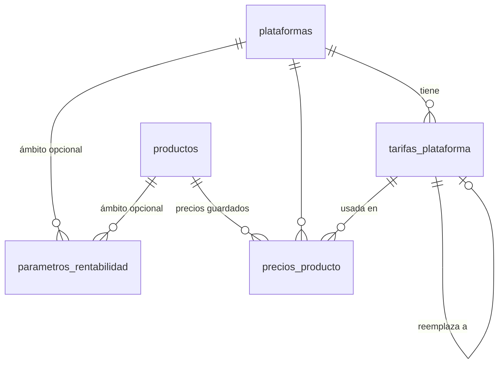

# Fase 2 — Plataformas, tarifas y motor de precios

**Entregable:** precio recomendado por canal.
**Fecha de cierre:** 18 de noviembre de 2026.
**Estado:** concluida. 50 pruebas automatizadas en verde (27 nuevas); regresión de la Fase 1 y de las funciones anteriores sin errores. Ver la sección 8.

**Decisiones del usuario al iniciar la fase:** objetivo general **margen 30 %**, **margen mínimo 10 %**, redondeo a **terminación 9**. El descuento promocional inicia en 0 % (no se definió) y el régimen fiscal sigue **pendiente**.

---

## 1. Alcance

| Incluido | Fuera de esta fase |
|---|---|
| Catálogo administrable de plataformas | Ventas con comisiones reales, cobros y devoluciones (Fase 3) |
| Tarifas por plataforma con vigencias e historial, criterios por tipo de publicación, modalidad logística, categoría, medio de pago, rango de precio, peso y tamaño | Precio publicado por canal y control de doble venta (Fase 3) |
| Objetivos de rentabilidad (margen, markup o utilidad fija) por categoría, juguete y plataforma | Competencia, dashboard y reportes (Fase 4) |
| Situación fiscal (régimen, IVA) con impuestos separados de los gastos | Actualización de tarifas por API oficial (Fase 5; queda el campo `Fuente`) |
| Motor de precios: equilibrio, mínimo, objetivo, sugerido, promocional, comisión, gastos, utilidad, margen y ROI | |
| Alertas, mejor canal, simulador, análisis de productos con filtros, orden y paginación, rentabilidad en la ficha del juguete | |
| Historial de precios recomendados | |

**No se capturó ninguna tarifa real.** El catálogo trae las plataformas, pero sin tarifas: mientras no captures la de una plataforma, ese canal aparece como "Sin tarifa" y no se calcula. Las pruebas usan tarifas ficticias marcadas como tales.

---

## 2. Requerimientos funcionales

| ID | Requerimiento |
|---|---|
| RF-2.1 | Catálogo de plataformas con alta, edición, tipo (marketplace, venta local, física) y activación. Iniciales: Facebook Marketplace, Mercado Libre Clásica, Mercado Libre Premium, Amazon México, WhatsApp Business y Ventas físicas, más los canales que ya existían en ventas (Grupos de Facebook, Conocidos, Bazar o escuela, Instagram). |
| RF-2.2 | Tarifas por plataforma con: comisión %, comisión por medio de pago %, cargo fijo, costo logístico, envío absorbido, almacenamiento, preparación, empaque, publicidad (% y fija), reserva por devoluciones %, retenciones de ISR e IVA, vigencia desde/hasta, estatus y notas de fuente. |
| RF-2.3 | Criterios opcionales por tarifa: tipo de publicación, modalidad logística, categoría, medio de pago, rango de precio, rango de peso y lado mayor. |
| RF-2.4 | "Nueva vigencia": cierra la tarifa actual el día anterior y crea la nueva, conservando la anterior sin cambios. |
| RF-2.5 | Objetivos de rentabilidad con esquema (margen sobre precio, markup sobre costo o utilidad fija), margen mínimo, descuento promocional y redondeo; por ámbito general, plataforma, categoría, categoría y plataforma, juguete, o juguete y plataforma. |
| RF-2.6 | Situación fiscal: régimen y cobro de IVA. Con régimen pendiente, los impuestos van en cero con un aviso visible. |
| RF-2.7 | Para cada juguete y canal: precio de equilibrio, mínimo, objetivo, sugerido y promocional; comisión, gastos, utilidad neta, margen y ROI. |
| RF-2.8 | Alertas: precio debajo del costo, venta con pérdida, debajo del mínimo, margen insuficiente, gastos logísticos mayores que la utilidad, canal no rentable. |
| RF-2.9 | Mejor canal: el que deja más utilidad vendiendo al mismo precio de referencia. |
| RF-2.10 | Simulador: juguete o costo capturado, plataforma, precio a probar, tipo de publicación, modalidad, medio de pago y fecha. Muestra desglose, depósito estimado y retenciones. |
| RF-2.11 | Análisis de productos con búsqueda, filtros (categoría, pallet, estado), orden (código, utilidad, margen, costo), paginación y fecha de tarifas. |
| RF-2.12 | Rentabilidad por canal en la ficha del juguete. |
| RF-2.13 | Guardar los precios calculados como recomendados, con historial (uno vigente por juguete y plataforma). |

## 3. Requerimientos no funcionales

| ID | Requerimiento | Cómo se cumple |
|---|---|---|
| RNF-2.1 | Sin tarifas en el código | Todos los cargos son datos con vigencia; el código no contiene montos de ninguna plataforma |
| RNF-2.2 | Exactitud | `decimal`; cada concepto del desglose se redondea al centavo y la utilidad se calcula con esos montos; precios redondeados **hacia arriba** |
| RNF-2.3 | Nunca debajo del mínimo | El objetivo, el sugerido y el promocional se limitan al mínimo (probado) |
| RNF-2.4 | Reproducible e histórico | Las tarifas no se sobrescriben al cambiar de vigencia; los precios guardados registran tarifa, objetivo, fecha y usuario |
| RNF-2.5 | Sin ambigüedad | Dos tarifas activas con los mismos criterios y vigencias traslapadas se rechazan |
| RNF-2.6 | Seguridad | Todos los endpoints requieren sesión; cambios auditados en la bitácora de la Fase 1 |
| RNF-2.7 | Preparado para APIs oficiales | Campo `Fuente` en tarifas y motor independiente de cómo se capturan las tarifas |

## 4. Reglas de negocio

Notación: **C** = costo real por pieza (Fase 1); **F** = cargos fijos por venta (cargo fijo + logística + envío absorbido + almacenamiento + preparación + empaque + publicidad fija); **p** = cargos porcentuales (comisión + medio de pago + publicidad % + reserva por devoluciones %); **f** = fracción del precio que es ingreso: 1, o 1/(1 + IVA) si se cobra IVA.

| ID | Regla |
|---|---|
| RN-2.1 | **Ingreso** de vender a precio P = P·f − P·p − F. **Utilidad** = ingreso − C. |
| RN-2.2 | **Equilibrio** = (C + F) / (f − p). |
| RN-2.3 | **Mínimo** = (C + F) / (f − p − m_min·f), con el margen mínimo aplicable. |
| RN-2.4 | **Objetivo:** margen m → (C + F)/(f − p − m·f); markup k → (C + F + k·C)/(f − p); utilidad fija u → (C + F + u)/(f − p). Nunca menor que el mínimo. |
| RN-2.5 | **Sugerido** = objetivo redondeado hacia arriba (terminación 9, múltiplo de 10, peso o centavo). |
| RN-2.6 | **Promocional** = sugerido × (1 − descuento), limitado al mínimo y redondeado hacia arriba; se indica cuando se limitó. |
| RN-2.7 | Equilibrio, mínimo y objetivo se redondean **hacia arriba** al centavo. |
| RN-2.8 | Si p (y el margen) suman 100 % o más del ingreso, el canal es **no rentable** y no se sugiere precio. |
| RN-2.9 | **Margen** = utilidad ÷ precio sin IVA. **ROI** = utilidad ÷ C. |
| RN-2.10 | **IVA trasladado** = P − P·f: no es ingreso ni gasto. **Retenciones** de ISR (sobre el precio sin IVA) y de IVA (sobre el IVA trasladado) no son gasto: se muestran aparte y se restan del **depósito estimado**. |
| RN-2.11 | **Depósito estimado** = P − comisiones − cargos de la plataforma (fijo, logística, envío, almacenamiento) − retenciones. Preparación, empaque, publicidad y reserva los paga el vendedor y no se descuentan del depósito. |
| RN-2.12 | **Tarifa aplicable:** activa y vigente en la fecha; criterios vacíos aplican a todo; gana la más específica. Sin tipo de publicación ni modalidad, se prefiere la **predeterminada**. Si la tarifa depende del precio, se elige la regla cuyo precio sugerido cae dentro de su propio rango. |
| RN-2.13 | Si hay tarifas por peso o tamaño y el juguete no tiene ese dato, el canal pide capturarlo; no se supone. |
| RN-2.14 | **Objetivo aplicable:** el más específico: juguete y plataforma › juguete › categoría y plataforma › categoría › plataforma › general. El general no se borra. |
| RN-2.15 | **Precio de referencia:** precio en México del juguete; si no hay, tu precio objetivo; si no, el sugerido. Con él se calculan el **mejor canal** y el estado. |
| RN-2.16 | **Alertas** al precio que planeas publicar (tu precio objetivo; si no lo capturaste, el sugerido). |
| RN-2.17 | **Estado del canal** al precio de referencia: Rentable (≥ objetivo), Margen bajo (entre mínimo y objetivo), Bajo el mínimo, Pérdida (utilidad < 0). |
| RN-2.18 | Con régimen fiscal pendiente no se aplica IVA aunque se marque, y se muestra el aviso. |

## 5. Modelo de datos (tablas nuevas)

**plataformas**: Id, Codigo (único), Nombre (único), Tipo (marketplace, local, fisica), Activa, Orden, Notas, CreadoUtc, ActualizadoUtc.

**tarifas_plataforma**
| Grupo | Campos |
|---|---|
| Identificación | Id, PlataformaId (FK restrict), Nombre, Fuente (manual), ReemplazaA (Id de la tarifa anterior), Notas |
| Criterios (nulos = todos) | TipoPublicacion, Modalidad, Categoria, MedioPago, PrecioMin, PrecioMax, PesoMinKg, PesoMaxKg, LadoMaxCm |
| Cargos de la plataforma | ComisionPct, ComisionMedioPagoPct, CargoFijo, CostoLogistico, EnvioAbsorbido, Almacenamiento |
| Gastos del vendedor | Preparacion, Empaque, PublicidadPct, PublicidadFija, ReservaDevolucionesPct |
| Retenciones | RetencionIsrPct (sobre precio sin IVA), RetencionIvaPct (sobre el IVA) |
| Vigencia | VigenteDesde, VigenteHasta (nulo = sin fin), Activa, Predeterminada |

Porcentajes de 0 a 100; montos en MXN ≥ 0; índice (PlataformaId, VigenteDesde).

**parametros_rentabilidad**: Id, Categoria, ProductoId (FK), PlataformaId (FK), Esquema (margen, markup, utilidad_fija), Valor, MargenMinimoPct, DescuentoPromocionalPct, Redondeo (terminacion9, diez, peso, centavo), Activo, Notas. Un objetivo por ámbito (validado). El margen mínimo no puede ser mayor que el margen objetivo.

**configuracion_fiscal** (Id = 1): Regimen (pendiente, resico, plataformas_tecnologicas, actividad_empresarial, persona_moral), CobraIva, TasaIvaPct, Notas.

**precios_producto**: Id, ProductoId, PlataformaId, TarifaId, ParametroId, FechaTarifa, Usuario, Costo, Equilibrio, Minimo, Objetivo, Sugerido, Promocional, Utilidad, MargenPct, Vigente (uno por juguete y plataforma), CreadoUtc.

---

## 6. Diseño técnico

| Componente | Archivo |
|---|---|
| Motor de precios y selección de tarifa (puro) | `Dominio/Calculo/MotorPrecios.cs` |
| Rentabilidad por juguete y canal | `Servicios/Rentabilidad.cs` |
| API | `Endpoints/PreciosApi.cs` |
| Entidades | `Models/EntidadesPrecios.cs` |
| Semillas y migración | `Data/Esquema.cs` (`SembrarFase2`) |
| Interfaz | `wwwroot/js/precios.js`; subnavegación en `analisis.js`; ficha en `app.js` |

### 6.1 API (todas requieren sesión)

| Método | Ruta | Uso |
|---|---|---|
| GET/POST | `/api/plataformas` | Lista (con tarifas vigentes y opciones de criterios) / alta |
| PUT | `/api/plataformas/{id}` | Editar, activar o desactivar |
| GET | `/api/plataformas/{id}/tarifas` | Tarifas e historial de vigencias |
| POST · PUT · DELETE | `/api/tarifas[/{id}]` | Alta, edición, baja (no se borra si hay precios guardados con ella) |
| POST | `/api/tarifas/{id}/nueva-vigencia` | Cierra la vigente y crea la nueva |
| GET/POST/PUT/DELETE | `/api/parametros-rentabilidad[/{id}]` | Objetivos de rentabilidad |
| GET/PUT | `/api/fiscal` | Situación fiscal |
| GET | `/api/rentabilidad/productos` | Lista paginada: `q, categoria, palletId, estado, orden, desc, pagina, tam, fecha` |
| GET | `/api/rentabilidad/productos/{id}` | Todos los canales de un juguete (`fecha, tipoPublicacion, modalidad, medioPago`) |
| POST | `/api/rentabilidad/simular` | Simulador |
| POST | `/api/rentabilidad/productos/{id}/guardar` | Guardar precios recomendados |
| GET | `/api/rentabilidad/productos/{id}/historial` | Historial de precios guardados |

### 6.2 Decisiones técnicas

| Decisión | Motivo |
|---|---|
| Motor puro separado del acceso a datos | Probado con aritmética exacta; mismo resultado desde la API, el simulador y la ficha |
| Tarifas como reglas con criterios y vigencia | Cubre clásica/premium, modalidades logísticas, rangos de precio y peso sin cambiar código |
| Tarifas dependientes del precio resueltas por consistencia | El cargo depende del precio y viceversa: se toma la regla cuyo precio resultante cae en su rango; si ninguna, la opción más conservadora y un aviso |
| Retenciones fuera de la utilidad | Son anticipos de impuestos, no gastos (el requerimiento pide no confundirlos) |
| Utilidad calculada desde conceptos ya redondeados | El desglose suma exactamente en pantalla |
| Plataformas sin tarifas al sembrar | El requerimiento prohíbe suponer tarifas |

---

## 7. Historias de usuario y criterios de aceptación

**HU-2.1 Capturar tarifas con vigencia.** Como dueño, quiero capturar lo que cobra cada plataforma y actualizarlo sin perder lo anterior.
- Al crear "Nueva vigencia" desde el 1 de diciembre, la anterior queda vigente hasta el 30 de noviembre con sus montos.
- Una tarifa duplicada con vigencia traslapada se rechaza con mensaje.

**HU-2.2 Conocer el precio por canal.** Como dueño, quiero saber a cuánto publicar un juguete en cada canal sin perder dinero.
- Para C = $315.90 y la tarifa de prueba de marketplace (15 % + $25 + $10): mínimo $467.87, objetivo $638.00, sugerido $639.
- El sugerido y el promocional nunca son menores que el mínimo.

**HU-2.3 Elegir el mejor canal.** Como dueño, quiero saber dónde me conviene vender.
- Vendiendo a $600, la venta local de prueba deja $234.10 y el marketplace $159.10: el mejor canal es la venta local.

**HU-2.4 Probar un precio.** Como dueño, quiero simular un precio y ver qué recibo.
- A $450 en el marketplace de prueba: comisión $67.50, cargos $25, gastos $10, utilidad $31.60 (7.02 %), depósito $357.50 y alerta "debajo del mínimo autorizado".

**HU-2.5 Fijar objetivos distintos.** Como dueño, quiero metas distintas por canal o juguete.
- Un objetivo de 20 % solo para Mercado Libre cambia su sugerido a $549 y deja los demás canales con el general.

---

## 8. Casos de prueba

Escenario: C = $315.90; objetivo margen 30 %, mínimo 10 %, terminación 9; sin IVA. **Tarifas de prueba (no reales):** Marketplace A = 15 % + $25 fijo + $10 de empaque; Venta local = $40 de traslado + $10 de empaque.

| # | Caso | Resultado esperado | Prueba |
|---|---|---|---|
| 8 | Precio mínimo | 350.90 ÷ 0.75 = $467.87; equilibrio 350.90 ÷ 0.85 = $412.83 | Unitaria + integración |
| 9 | Precio objetivo | 350.90 ÷ 0.55 = $638.00 → sugerido $639; markup 50 % → $598.65; utilidad fija $100 → $530.48 | Unitaria + integración |
| 10 | Margen | A $639: comisión $95.85, utilidad $192.25, margen 30.09 %, ROI 60.86 %, depósito $518.15 | Unitaria + integración |
| 11 | Comparación entre plataformas | Local: sugerido $529, utilidad $163.10. A $600: local $234.10 vs. marketplace $159.10 → mejor canal: local | Unitaria + integración |
| 17 | Actualización de tarifas | 15 % hasta el 30-nov → $639; 17 % desde el 1-dic → objetivo $662.08, sugerido $669; la anterior conserva su 15 % | Unitaria + integración |
| — | Tarifa por rango de precio | Cargo de $25 solo hasta $298.99: C = $100 → $229 (rango bajo); C = $200 → $369 (rango alto) | Unitaria |
| — | Tarifa por peso sin peso | Pide capturar el peso | Unitaria |
| — | IVA y retenciones | P = $1,160 con IVA 16 %: ingreso $1,000, IVA $160, utilidad $500 (costo $500), retención ISR 1 % = $10, IVA 50 % = $80, depósito $1,070 | Unitaria + integración |
| — | Promocional | 40 % → limitado al mínimo: $469; 10 % → $579 | Unitaria |
| — | Alertas | $300 debajo del costo; $400 pérdida; $450 debajo del mínimo; $500 margen insuficiente; $639 sin alertas; mínimo > mercado → no rentable; envío $150 > utilidad → logística | Unitaria |
| — | Objetivos por ámbito | Plataforma 20 % → $549 solo en ese canal; mínimo > objetivo rechazado; el general no se borra | Integración |
| — | Historial | Guardar dos veces → 4 registros, 2 vigentes; la tarifa usada no se puede borrar | Integración |

**Ejecución:** `dotnet test PalletControl.sln` → **50 de 50** (34 unitarias, 16 de integración).

### 8.1 Pruebas de navegador (fuera del repositorio)
- **Flujo Fase 2:** captura de tarifas desde la pantalla → análisis de productos (mejor canal y estado) → detalle → guardar precios → historial → simulador a $450 (alerta de mínimo) → nueva vigencia al 17 % (ML al 1-dic: $669) → objetivo por plataforma → rentabilidad en la ficha → celular de 390 px. Sin errores en la consola; cifras iguales a la tabla anterior.
- **Regresión:** flujo completo de la Fase 1; inventario, ventas y sincronización entre dos navegadores; precios por tienda, carrusel y traducción; imágenes, tipo de cambio y valor del pallet. Sin errores.
- **Migración:** base de la Fase 1 con pallet costeado → 10 plataformas, objetivo general 30/10 %, fiscal pendiente; datos, costos y sesión intactos.

---

## 9. Manual de usuario (Fase 2)

### 1. Captura las tarifas
*Análisis comercial › Plataformas y tarifas › (plataforma) › Tarifas › + Tarifa.* Toma los valores de la página oficial o de tu contrato. Separa lo que cobra la plataforma de tus propios gastos (empaque, preparación). Si una plataforma cobra distinto según el tipo de publicación o el envío, captura una tarifa por cada caso y marca como **predeterminada** la que usas normalmente.

Cuando una plataforma cambie sus tarifas, usa **Nueva vigencia**: no edites la tarifa anterior.

### 2. Revisa tus objetivos
En la misma pantalla, **Objetivos de rentabilidad**: el general está en margen 30 % y mínimo 10 %. Agrega objetivos distintos para un canal, una categoría o un juguete.

### 3. Situación fiscal
Mientras esté "Pendiente", los precios no incluyen IVA ni ISR. Cuando tu contador te confirme el régimen, captúralo y, si aplica, las retenciones en cada tarifa.

### 4. Consulta los precios
- **Análisis de productos:** el mejor canal de cada juguete, su utilidad y estado. Clic en el nombre para ver todos los canales y **guardar los precios recomendados**.
- **Ficha del juguete:** sección *Rentabilidad por canal*.
- **Simulador:** prueba un precio y ve cuánto te deposita la plataforma y cuánto ganas.

---

## 10. Pendientes y riesgos

| # | Tema | Detalle |
|---|---|---|
| 1 | **Capturar tarifas reales** | Ningún canal tiene tarifa: hasta capturarlas, todos aparecen como "Sin tarifa". |
| 2 | Régimen fiscal | Sigue pendiente; sin él no se separan IVA ni ISR. |
| 3 | Descuento promocional | Está en 0 %; defínelo si harás promociones. |
| 4 | Peso y medidas | Si capturas tarifas por peso o tamaño, los juguetes sin esos datos no tendrán precio en ese canal. |
| 5 | IVA acreditable | No se modela hasta definir el régimen (las comisiones de plataforma suelen incluir IVA). |
| 6 | Precio de referencia | El mejor canal depende del precio en México capturado; sin él se usa tu precio objetivo o el sugerido. |
| 7 | Rendimiento | El análisis se calcula al momento para todos los juguetes; adecuado para cientos de juguetes. Para miles, convendrá guardar resultados (Fase 4). |
